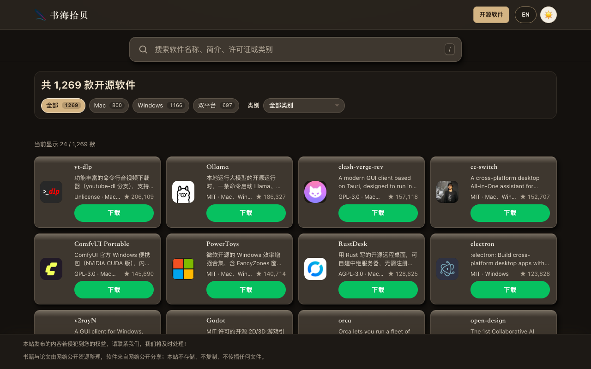

# 开源软件目录

欢迎来到《开源软件》· 软件目录，收录 1,269 款开源软件。英文名是 Open Source Apps。无论你用 Mac、Windows，还是双平台，这里都能查到。

https://www.embassygrade.com/open-source.html



## 打开

请用静态服务器打开，不要依赖 `file://`。

```bash
python3 -m http.server 8812
```

然后打开 <http://127.0.0.1:8812/>。详情页是 `open-source-app.html?id=...`。

下载入口在 `assets/open-source-downloads.js`。下载弹窗只使用仓库里已经写好的链接，不会另外编造地址。没有单独的点击统计接口。软件头像在 `assets/open-source-avatars/`。

许可证待定。
